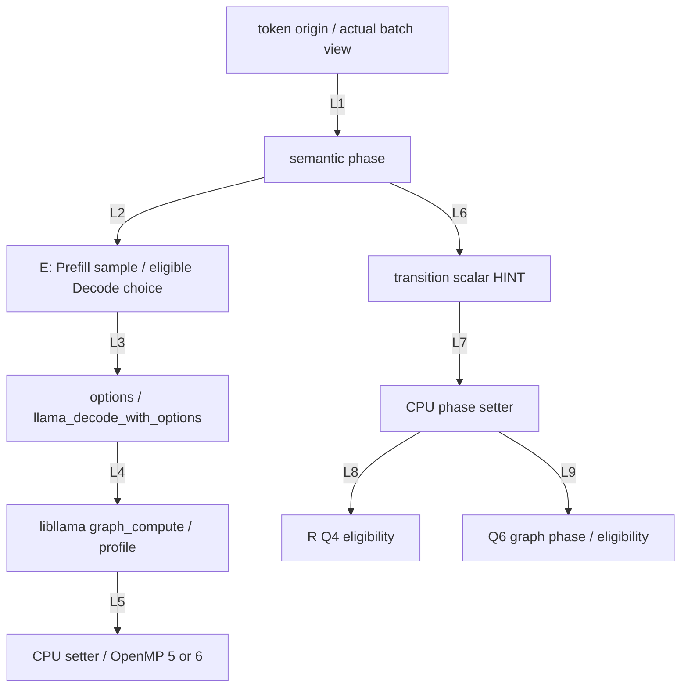
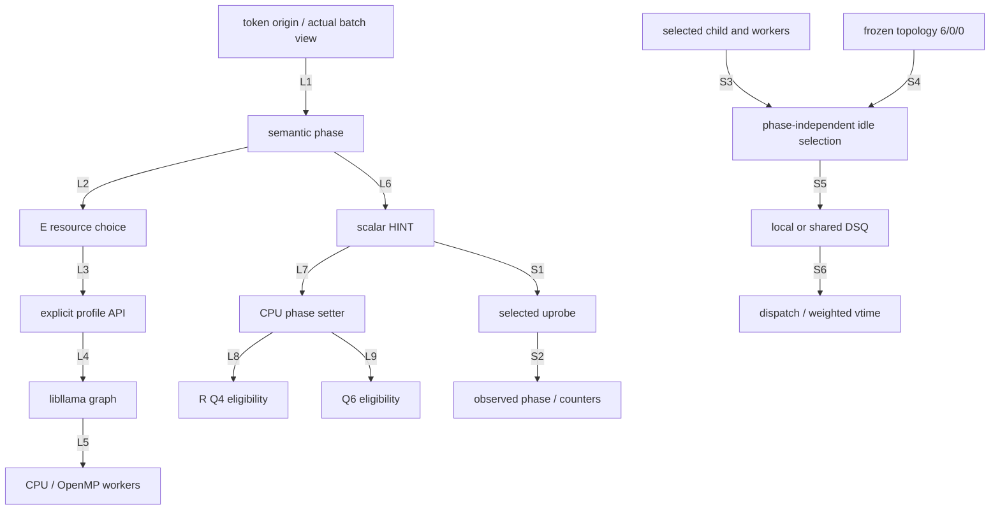

# 최종 source-to-runtime 통합 경로

각 화살표의 L/S 번호는 아래 표의 **원본 경로:행번호·전체 SHA256·실행 증거**에 대응한다. 선택 source 발췌의 행번호도 원본 기준이다. “실행 증거”는 source, build, loaded ELF, epoch/진단을 결합한 근거이며 모든 함수에 연속 tracing을 했다는 뜻은 아니다.

## A_L: Linux에서의 runtime 연결

텍스트 경로: token-origin → 실제 제출 view의 semantic phase → E의 Prefill 관측/Decode 선택 → explicit profile → libllama graph → CPU setter/OpenMP. 별도 가지는 같은 semantic phase → transition scalar → CPU backend phase setter → Q4/Q6 eligibility다. kernel scheduler가 없어도 두 runtime 가지는 동작한다.

## A_S: 동일 runtime과 kernel 실행·관측

텍스트 경로: A_L의 L1~L9를 그대로 사용한다. scalar marker를 selected uprobe가 받아 관측 state/bitmap/counter에 기록한다. 별도로 선택 child만 SCHED_EXT에 들어가 frozen topology, idle tier, local/shared DSQ, weighted-vtime 정책으로 실행된다. phase 관측에서 placement로 가는 화살표나 kernel→E feedback 화살표는 없다.

## 화살표별 근거

### L1: token origin → actual view semantic classifier

- 출발: `src/llama/tools/server/server-context.cpp:3754` (classification); SHA256 `85a9650aada34a5b0b726ac427dbe268ac625442f15ec68a7674c1520d455685`; [source](https://github.com/codinghuman0/llama-scheduler/blob/25ab433140eafc6cbb3b259b017c2a9252b37900/new-a-workspace/experiments/final-team-integration-audit-v1/sources/excerpts/semantic-origin.txt)
- 도착: `src/llama/tools/server/server-context.cpp:2957` (retry-view); SHA256 `85a9650aada34a5b0b726ac427dbe268ac625442f15ec68a7674c1520d455685`; [source](https://github.com/codinghuman0/llama-scheduler/blob/25ab433140eafc6cbb3b259b017c2a9252b37900/new-a-workspace/experiments/final-team-integration-audit-v1/sources/excerpts/semantic-origin.txt)
- 실행 연결: 원래 decode-origin541/prompt-origin3615; split3902. 실제 epoch phase counts. Mixed는 token origin이 아니라 view의 합성 판정.

### L2: semantic phase → E select

- 출발: `src/llama/tools/server/server-context.cpp:3780` (profile-selection); SHA256 `85a9650aada34a5b0b726ac427dbe268ac625442f15ec68a7674c1520d455685`; [source](https://github.com/codinghuman0/llama-scheduler/blob/25ab433140eafc6cbb3b259b017c2a9252b37900/new-a-workspace/experiments/final-team-integration-audit-v1/sources/excerpts/semantic-origin.txt)
- 도착: `src/llama/tools/server/newa-prefill-pressure.h:186` (select); SHA256 `944b2b546427fb97b7e5584c0a383ad97cbea04a987cf1a303fa69a4c01afe4d`; [source](https://github.com/codinghuman0/llama-scheduler/blob/25ab433140eafc6cbb3b259b017c2a9252b37900/new-a-workspace/experiments/final-team-integration-audit-v1/sources/excerpts/E.txt)
- 실행 연결: observed-usage measured epoch: phase, task/position guard, sample validity, actual choice.

### L3: E choice → options/API

- 출발: `src/llama/tools/server/newa-prefill-pressure.h:186` (select); SHA256 `944b2b546427fb97b7e5584c0a383ad97cbea04a987cf1a303fa69a4c01afe4d`; [source](https://github.com/codinghuman0/llama-scheduler/blob/25ab433140eafc6cbb3b259b017c2a9252b37900/new-a-workspace/experiments/final-team-integration-audit-v1/sources/excerpts/E.txt)
- 도착: `src/llama/tools/server/server-context.cpp:3833` (decode-api); SHA256 `85a9650aada34a5b0b726ac427dbe268ac625442f15ec68a7674c1520d455685`; [source](https://github.com/codinghuman0/llama-scheduler/blob/25ab433140eafc6cbb3b259b017c2a9252b37900/new-a-workspace/experiments/final-team-integration-audit-v1/sources/excerpts/semantic-origin.txt)
- 실행 연결: A server ELF unresolved llama_decode_with_options + libllama export; raw decisions5/6.

### L4: decode API → graph compute/profile resolve

- 출발: `src/llama/src/llama-context.cpp:4122` (api); SHA256 `5e7b81b3ddcc851fcb0e9dbf49b6ba1cb663b677d25de2a2b8eca31d42670f0a`; [source](https://github.com/codinghuman0/llama-scheduler/blob/25ab433140eafc6cbb3b259b017c2a9252b37900/new-a-workspace/experiments/final-team-integration-audit-v1/sources/excerpts/profile-engine.txt)
- 도착: `src/llama/src/llama-context.cpp:2457` (graph); SHA256 `5e7b81b3ddcc851fcb0e9dbf49b6ba1cb663b677d25de2a2b8eca31d42670f0a`; [source](https://github.com/codinghuman0/llama-scheduler/blob/25ab433140eafc6cbb3b259b017c2a9252b37900/new-a-workspace/experiments/final-team-integration-audit-v1/sources/excerpts/profile-engine.txt)
- 실행 연결: base59와 final llama-context byte identity; archived compile/link + loaded libllama dcd9ba…; graph 호출마다 직접 tracing한 것은 아님.

### L5: graph profile → CPU setter/OpenMP

- 출발: `src/llama/src/llama-context.cpp:2477` (threads-setter); SHA256 `5e7b81b3ddcc851fcb0e9dbf49b6ba1cb663b677d25de2a2b8eca31d42670f0a`; [source](https://github.com/codinghuman0/llama-scheduler/blob/25ab433140eafc6cbb3b259b017c2a9252b37900/new-a-workspace/experiments/final-team-integration-audit-v1/sources/excerpts/profile-engine.txt)
- 도착: `src/llama/ggml/src/ggml-cpu/ggml-cpu.c:3514` (team); SHA256 `cc4366fb2ed1fa466958557e8d631eda1a73b4d144498b98d969a9b5e0fdd13e`; [source](https://github.com/codinghuman0/llama-scheduler/blob/25ab433140eafc6cbb3b259b017c2a9252b37900/new-a-workspace/experiments/final-team-integration-audit-v1/sources/excerpts/CPU-graph.txt)
- 실행 연결: CPU setter256, registry655; 실제 libgomp NEED + team 보고. pool setter2471은 off여도 thread setter를 막지 않음.

### L6: semantic phase → transition scalar

- 출발: `src/llama/tools/server/server-context.cpp:3825` (transition); SHA256 `85a9650aada34a5b0b726ac427dbe268ac625442f15ec68a7674c1520d455685`; [source](https://github.com/codinghuman0/llama-scheduler/blob/25ab433140eafc6cbb3b259b017c2a9252b37900/new-a-workspace/experiments/final-team-integration-audit-v1/sources/excerpts/semantic-origin.txt)
- 도착: `src/llama/tools/server/server-phase.h:47` (transition-state); SHA256 `9b6165627fbb8f775a50fbc574a08d30914aae9ee3ca6679b3450ec3f79f459b`; [source](https://github.com/codinghuman0/llama-scheduler/blob/25ab433140eafc6cbb3b259b017c2a9252b37900/new-a-workspace/experiments/final-team-integration-audit-v1/sources/excerpts/phase-classifier.txt)
- 실행 연결: HINT define/TRACE 미정의; 최종 server에 llama_scx_phase_v1 export. 동일 phase 재방출 생략.

### L7: scalar → registry/CPU phase setter

- 출발: `src/llama/tools/server/server-scx.h:17` (setter-lookup); SHA256 `655e62843596e98e66920b6b8d12e868ea0a01df96a5020c0ee6cc86d26f303f`; [source](https://github.com/codinghuman0/llama-scheduler/blob/25ab433140eafc6cbb3b259b017c2a9252b37900/new-a-workspace/experiments/final-team-integration-audit-v1/sources/excerpts/phase-bridge.txt)
- 도착: `src/llama/ggml/src/ggml-cpu/ggml-cpu.cpp:653` (registry); SHA256 `8ab6ed68e2c0eea05090368d7788636500d146851298685276d7a9302c03c5c1`; [source](https://github.com/codinghuman0/llama-scheduler/blob/25ab433140eafc6cbb3b259b017c2a9252b37900/new-a-workspace/experiments/final-team-integration-audit-v1/sources/excerpts/CPU-registry.txt)
- 실행 연결: CPU phase setter481과 registry653. ELF export 및 별도 R route 진단으로 경로 사용 확인.

### L8: CPU phase → Q4 eligibility

- 출발: `src/llama/ggml/src/ggml-cpu/ggml-cpu.c:481` (phase-setter); SHA256 `cc4366fb2ed1fa466958557e8d631eda1a73b4d144498b98d969a9b5e0fdd13e`; [source](https://github.com/codinghuman0/llama-scheduler/blob/25ab433140eafc6cbb3b259b017c2a9252b37900/new-a-workspace/experiments/final-team-integration-audit-v1/sources/excerpts/CPU-graph.txt)
- 도착: `experiments/r-pool-validation-v1/candidates/R/overlay/ggml/src/ggml-cpu/newa-q4-policy.h:38` (eligibility); SHA256 `014ec3787142838295cb9e8193453ea504cf7a27f18c14a0fa6b8799fcd93029`; [source](https://github.com/codinghuman0/llama-scheduler/blob/25ab433140eafc6cbb3b259b017c2a9252b37900/new-a-workspace/experiments/final-team-integration-audit-v1/sources/excerpts/Q4-R.txt)
- 실행 연결: R 진단 reference Prefill3935, exact Decode167201/Mixed2656. final timing 자체의 per-call trace는 없음.

### L9: CPU phase → Q6 graph phase/eligibility

- 출발: `src/llama/ggml/src/ggml-cpu/ggml-cpu.c:3511` (phase-load); SHA256 `cc4366fb2ed1fa466958557e8d631eda1a73b4d144498b98d969a9b5e0fdd13e`; [source](https://github.com/codinghuman0/llama-scheduler/blob/25ab433140eafc6cbb3b259b017c2a9252b37900/new-a-workspace/experiments/final-team-integration-audit-v1/sources/excerpts/CPU-graph.txt)
- 도착: `src/llama/ggml/src/ggml-cpu/newa-q6-policy.h:39` (phase); SHA256 `605cf933b96dc6ee4af7c635bdddb4dcdb04429d215b538bf0e59849f30b6d42`; [source](https://github.com/codinghuman0/llama-scheduler/blob/25ab433140eafc6cbb3b259b017c2a9252b37900/new-a-workspace/experiments/final-team-integration-audit-v1/sources/excerpts/Q6-policy.txt)
- 실행 연결: R 진단 Q6 worker0 chunks Prefill15739/Decode462873/Mixed14003.

### S1: scalar marker ELF → selected uprobe

- 출발: `src/llama/tools/server/server-scx.h:11` (marker); SHA256 `655e62843596e98e66920b6b8d12e868ea0a01df96a5020c0ee6cc86d26f303f`; [source](https://github.com/codinghuman0/llama-scheduler/blob/25ab433140eafc6cbb3b259b017c2a9252b37900/new-a-workspace/experiments/final-team-integration-audit-v1/sources/excerpts/phase-bridge.txt)
- 도착: `scheduler/neutral_lifecycle.c:344` (uprobe); SHA256 `65ab6db95be1c94faa6bcd38de9d3d9c4c2b95408ee14221b6b3ccb51f2709b5`; [source](https://github.com/codinghuman0/llama-scheduler/blob/25ab433140eafc6cbb3b259b017c2a9252b37900/new-a-workspace/experiments/final-team-integration-audit-v1/sources/excerpts/scheduler-lifecycle.txt)
- 실행 연결: 동결 marker ELF9204b0…; selected-child registration/loaded BPF identity. 기존 runtime/scheduler raw.

### S2: uprobe → observed phase state/counters

- 출발: `scheduler/handoff.bpf.c:408` (uprobe); SHA256 `c54dfa5b73e9eb09c981be8e9608b1c62c51ed950ed0468aa79a1f982520c736`; [source](https://github.com/codinghuman0/llama-scheduler/blob/25ab433140eafc6cbb3b259b017c2a9252b37900/new-a-workspace/experiments/final-team-integration-audit-v1/sources/excerpts/scheduler.txt)
- 도착: `scheduler/handoff.bpf.c:335` (handoff); SHA256 `c54dfa5b73e9eb09c981be8e9608b1c62c51ed950ed0468aa79a1f982520c736`; [source](https://github.com/codinghuman0/llama-scheduler/blob/25ab433140eafc6cbb3b259b017c2a9252b37900/new-a-workspace/experiments/final-team-integration-audit-v1/sources/excerpts/scheduler.txt)
- 실행 연결: phase_seen bitmap14; Decode attempt 누적. NEW_A_IDLE_HANDOFF 미정의, moved0.

### S3: selected worker → scheduler callbacks

- 출발: `scheduler/llama_scx_child.c:168` (policy); SHA256 `93638218e23ccacd061b35594e69c4900fef382918ec715fda55278cb263ba11`; [source](https://github.com/codinghuman0/llama-scheduler/blob/25ab433140eafc6cbb3b259b017c2a9252b37900/new-a-workspace/experiments/final-team-integration-audit-v1/sources/excerpts/selected-child.txt)
- 도착: `scheduler/handoff.bpf.c:278` (select); SHA256 `c54dfa5b73e9eb09c981be8e9608b1c62c51ed950ed0468aa79a1f982520c736`; [source](https://github.com/codinghuman0/llama-scheduler/blob/25ab433140eafc6cbb3b259b017c2a9252b37900/new-a-workspace/experiments/final-team-integration-audit-v1/sources/excerpts/scheduler.txt)
- 실행 연결: selected server/workers policy7 + fixed mask, 일반 launcher/load policy0; partial struct_ops 연결.

### S4: frozen topology → idle CPU tier

- 출발: `scheduler/loader.c:48` (topology); SHA256 `005f9f2a5b6d740c300bc60668af4cb1af6eb051d40dca8d6466bca33dbbc6c1`; [source](https://github.com/codinghuman0/llama-scheduler/blob/25ab433140eafc6cbb3b259b017c2a9252b37900/new-a-workspace/experiments/final-team-integration-audit-v1/sources/excerpts/scheduler-loader.txt)
- 도착: `scheduler/handoff.bpf.c:249` (tier); SHA256 `c54dfa5b73e9eb09c981be8e9608b1c62c51ed950ed0468aa79a1f982520c736`; [source](https://github.com/codinghuman0/llama-scheduler/blob/25ab433140eafc6cbb3b259b017c2a9252b37900/new-a-workspace/experiments/final-team-integration-audit-v1/sources/excerpts/scheduler.txt)
- 실행 연결: 각 loader log enabled1 tiers6/0/0; frozen topology identity; phase 입력 없이 idle/allowed/online 검사.

### S5: idle select / enqueue → local/shared DSQ

- 출발: `scheduler/handoff.bpf.c:278` (select); SHA256 `c54dfa5b73e9eb09c981be8e9608b1c62c51ed950ed0468aa79a1f982520c736`; [source](https://github.com/codinghuman0/llama-scheduler/blob/25ab433140eafc6cbb3b259b017c2a9252b37900/new-a-workspace/experiments/final-team-integration-audit-v1/sources/excerpts/scheduler.txt)
- 도착: `scheduler/handoff.bpf.c:362` (enqueue); SHA256 `c54dfa5b73e9eb09c981be8e9608b1c62c51ed950ed0468aa79a1f982520c736`; [source](https://github.com/codinghuman0/llama-scheduler/blob/25ab433140eafc6cbb3b259b017c2a9252b37900/new-a-workspace/experiments/final-team-integration-audit-v1/sources/excerpts/scheduler.txt)
- 실행 연결: tier/fallback selected counters, running/stopping; idle local DSQ, otherwise shared vtime queue.

### S6: shared DSQ → dispatch / weighted vtime

- 출발: `scheduler/handoff.bpf.c:374` (dispatch); SHA256 `c54dfa5b73e9eb09c981be8e9608b1c62c51ed950ed0468aa79a1f982520c736`; [source](https://github.com/codinghuman0/llama-scheduler/blob/25ab433140eafc6cbb3b259b017c2a9252b37900/new-a-workspace/experiments/final-team-integration-audit-v1/sources/excerpts/scheduler.txt)
- 도착: `scheduler/handoff.bpf.c:389` (weight); SHA256 `c54dfa5b73e9eb09c981be8e9608b1c62c51ed950ed0468aa79a1f982520c736`; [source](https://github.com/codinghuman0/llama-scheduler/blob/25ab433140eafc6cbb3b259b017c2a9252b37900/new-a-workspace/experiments/final-team-integration-audit-v1/sources/excerpts/scheduler.txt)
- 실행 연결: DSQ callbacks 소스와 FULL counters; used slice*100/weight, Linux scx_simple 공통 기반.

## 실행 의미와 안전 경계

`server_batch::token`은 slot/task/position과 Prefill/Decode origin을 보유한다. `off .. off+batch_view.n_tokens`를 집계하므로 논리 batch 전체가 아니라 이번 제출 view를 판별한다. split/retry는 새 view로 다시 호출한다. n_unknown이 있으면 Unknown, 두 origin이 있으면 Mixed다. AUTO의 physical ubatch token-count 선택과 semantic phase 선택은 별개다.

E는 선택 CPU의 `/proc/stat` user/nice/system 증가량에서 process CPU upper bound와 tick rounding을 보정하고 0.02 core margin을 뺀 score를 0.125와 비교한다. 순수 Prefill >=32 tokens, model call >=1초, counter read <=20ms가 필요하다. 첫 Decode의 표본 age<=10초, 8-task/slot/seq/position 연속성, 이후 active subset tail, 최대256 eligible calls 조건을 검증한다. 적격 multi-token Decode만 pressure/fixed6 차이가 생기고 single-token Decode는5, Unknown/Mixed와 보수적 fallback은6이다. 실패 결과는 proposed epoch에 commit하지 않고 idle/reset한다. E idle reset은 scalar last-emitted phase에 v2 idle 이벤트를 추가하는 것이 아니다.

E의 센서는 매 Decode 재측정하지 않는다. source에 ambient/cpu25 조건명이나 답변 token 내용으로 선택하는 경로가 없다. [bounded search](https://github.com/codinghuman0/llama-scheduler/blob/25ab433140eafc6cbb3b259b017c2a9252b37900/new-a-workspace/experiments/final-team-integration-audit-v1/evidence/feedback-search.json)의 대상은 server/context, E helper, scalar bridge, libllama context, CPU C/C++와 정적 ELF dependency다. 결과는 NOT_FOUND_IN_SCOPE이지 모든 파일·미래 구현의 부재 증명은 아니다.

R Q4는 semantic Prefill에서 false를 반환해 기준 body로 간다. Decode/Mixed exact tile은 phase_batch와 원래의 shape 경계를 만족할 때 유지된다. Q6는 graph 시작 시 CPU phase를 읽는다. HINT는 kernel uprobe 외에도 이 eligibility를 전달하므로 HINT OFF 비교는 순수 scheduler off가 아니다. final HINT ON/TRACE OFF에서는 80-byte begin/end TRACE와 worker 진단 경로가 활성화되지 않는다. v2의 32-byte active/idle ABI와 혼동하지 않는다.

observe는 FULL 진단에서 phase를 읽고 attempt를 셀 수 있지만 이동 분기는 compile되지 않았다. `FG_GUARD` macro가 없더라도 selected-child/fixed-affinity loader monitor는 실제 활성이다. dynamic-affinity 문제를 해결했다고 주장하지 않는다. tier6/0/0은 AMD에서 여섯 physical CPU를 하나의 tier에 넣은 구성으로 Intel P/E 성과가 아니다.

## source → build → binary → loaded chain

| 부분 | source/build 근거 | 실제 binary/loaded 연결 |
|---|---|---|
| B0 | historical commit7a2db1a0, 보존 rebuild identity | cases의 B0 server32a3cc…/CPU927db1…/libllama4bf5f8…와 raw loaded 기록 |
| shared libllama | base59의 llama-context/header가 final과 byte-identical; archived compile_commands, link.txt/flags.make | libllama dcd9ba… 유지. prefill-attention overlay가 다른 graph 파일에 있으므로 전체 libllama가 base59 무수정이라는 뜻은 아님 |
| E server | 보존 pressure identity에 context85a965…/helper944b2b…/bridge655e62…, HINT compile/link 및 parent relink identity | server-impl9204b0… 그대로 A/F6/S에 로드; API symbol과 scalar marker 확인 |
| R CPU | pre-R CPU compilation/header input match, archived O3/native/OpenMP options + R policy014ec3… | CPU45ddfa…를 A/F6/S가 로드; diag variant의 별도 route proof를 timing으로 쓰지 않음 |
| scheduler | 보존 observe compile.log의 FULL defines, workspace loader 재링크 기록과 source identities | loaderbb3e08…/BPFcb63e7…/childac4d0b…와 실제 A_S raw attachment/정리 |
| P | donor header61a61c… + P context378d0f… + padding patch; full server link/parent byte-identical relink | P server250671…와 A server9204b0…는 다름. arithmetic DSO는 동일; P lifecycle만 donor owner 사용 |

전체 hash는 [release map](https://github.com/codinghuman0/llama-scheduler/blob/25ab433140eafc6cbb3b259b017c2a9252b37900/new-a-workspace/experiments/final-team-integration-audit-v1/evidence/preserved/a-component-scheduler-replication-v1/frozen-release-map.json), [static ELF](https://github.com/codinghuman0/llama-scheduler/blob/25ab433140eafc6cbb3b259b017c2a9252b37900/new-a-workspace/experiments/final-team-integration-audit-v1/evidence/static-elf.json), [314개 source/artifact/loaded 재확인](https://github.com/codinghuman0/llama-scheduler/blob/25ab433140eafc6cbb3b259b017c2a9252b37900/new-a-workspace/experiments/final-team-integration-audit-v1/evidence/identity-recheck.json)에 있다. 정적 symbol은 포함 증거이고, raw loaded/epoch/route/lifecycle 자료가 실행 근거를 보강한다. `nm`에서 함수가 없다는 한 가지 사실만으로 donor 부재를 판정하지 않고, source와 compile identity도 대조했다.

단일 폴더에는 여러 역사적 overlay/DSO가 모여 있다. `src/llama`의 Q4 policy는 pre-R이므로 R 설명에 그 파일을 대신 쓰지 않았다. R overlay 경로를 사용했다. 최신 HEAD를 과거 measured source로 대체하지 않았다. clean 단일 commit 재빌드는 이번 감사에서 하지 않았고 가능 여부를 확정하지 않는다.

## 실제 BPF attachment/tag 재확인

36개 보존 A_S visit에서 선택 phase uprobe의 prog_id/perf link와 loader PID, marker offset `0x185b40`, marker ELF SHA9204b0…를 대조했다. 전후 sched_ext enabled/ops llama_new_a/switch_all0와 enable_seq 불변, watchdog PASS, cleanup disabled/PASS를 확인했다. llama_phase tag는 `92f7d26cd8cee605`, select_cpu는 `eac23804699dd10e`, enqueue는 `99b2a8a7af4a3c17`, dispatch는 `8b127bb7e17b5265`로 모든 visit에서 일치했다. [visit별 ID/tag와 근거](https://github.com/codinghuman0/llama-scheduler/blob/25ab433140eafc6cbb3b259b017c2a9252b37900/new-a-workspace/experiments/final-team-integration-audit-v1/evidence/scheduler-attachments.json). 이는 기존 기록 재검사이며 기록 속 sudo/bpftool 명령을 실행한 것이 아니다. watchdog은 표본 검사이므로 모든 순간을 연속 tracing했다는 주장은 하지 않는다.
