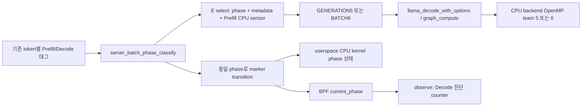

# 최종 E(Prefill pressure) 소스 감사

감사 상태: **AUDIT_COMPLETE_WITH_LIMITATIONS**. 소스 정체, 데이터 흐름 및 기존 증거를 검토했다. 새로운 실행 성능·품질 시험은 수행하지 않았다.

**핵심 결론:** E는 기존 semantic batch classifier의 같은 결과를 재사용하여 CPU graph의 5/6-worker profile을 선택한다. 최종 C의 커널 variant는 `observe`다. phase를 전달받고 Decode 조건에서 진단 카운터를 올리지만, phase에 따라 CPU를 옮기고 깨우는 부분은 빌드에서 꺼져 있다. 감사 범위 내에서 scheduler map/statistics를 E 선택기로 되돌리는 명시적 경로는 발견하지 못했다. 외부 CPU 사용량 추정은 `/proc/stat`과 process CPU clock을 이용한다.

아래 `E`, `PHASE`, `SCX` 등의 source ID는 마지막 source index에서 **원본 절대 경로·전체 SHA256·패키지 경로**로 연결된다. 줄 번호는 변형하지 않은 전체 소스 기준이다.

## 1. 측정 대상의 정체

| Arm | Runtime | Scheduler | 이번 E 정책 |
|---|---|---|---|
| B0 | 원래 revision `7a2db1a0cf38e5f4eb278a58c3903d295258d0ea`의 정확한 소스 재빌드 | 기본 Linux | 없음 |
| B1 | 연구 시작 때 동결한 NEW_A `B1_start_q4_exact` | 기본 Linux | 없음; legacy profile |
| C | 동일 B1 연산 DSO + E `NEW_A_prefill_pressure_v2` server overlay | selected-child `observe`, FULL guard | `NEWA_DECODE_RESOURCE=pressure`, phase profile |
| C-off | C와 같은 E binary 및 기존 Q4/Q6 kernel | C와 같은 `observe` | `fixed6`; 기존 single-token Decode5는 유지 |

`selection-freeze.json:cases`, `identity/B0/identity.json`, `identity/B1.json`, E `identity.json`과 실제 `runtime.json`을 따라 식별했다. B0의 역사적 실행 바이너리 자체는 남지 않았으므로 **역사적 소스 재빌드**라는 제한을 유지한다. B1은 `59abec45fe0919de20550ce7cdcf363d9f7bbe5a` 기반의 여러 worktree/overlay 조합이다. server/common은 `llama-phase-barrier`, libllama는 `llama-prefill-attention-v2`, libggml-cpu는 `llama-phase-batch-q4-exact-v1`에서 왔다. 현재 HEAD 하나로 측정 정체를 대신하지 않았다.

최종 E의 실질 변화는 server-impl DSO다. 완전한 `sources/runtime-E/method.patch`는 B1 server-context(hash `37446911eb50346a4762e300ba7fc1a28e6d2c8f32d5972a95bb02de19dcb502`)에 대한 diff와 새 helper를 함께 포함한다. E artifact 하위의 같은 이름 patch는 server diff만 있으므로 이를 대체품으로 내보내지 않았다. 이번 감사에서는 메모리에서 만든 canonical diff가 최종 patch와 동일함을 확인했다. 기존 git-apply 검사 증거는 별도 복사했으며 새 git apply는 수행하지 않았다. 실제 E 빌드는 직전 decode-policy overlay의 나머지 object를 재사용하고 정확한 parent relink를 검증한 뒤 helper와 server-context를 교체했다. 그 commands/inputs/identity를 함께 포함했다.

실제 marker ELF는 `.../artifacts/runtime-prefill-pressure-v2/runtime/bin/libllama-server-impl.so`, SHA256 `9204b0d4e45d4b5437c61417afe912d55618ce62ece6b6adf83ca7967dbe8cfc`다. 실제 observe loader hash는 `6123f1e5b12ff665a2f18513eac0c13762204a49e6e3b15311872607e64ada97`, FULL BPF object hash는 `cb63e744df618ae46e2fe101d842fb7fefed51e2dd581daef80662322b358c47`이다. `identity/start-scheduler.json`의 최상위 loader 문자열만 보면 다른 variant와 혼동할 수 있다. 실제 case 선택, `loader-command.json`, 생성 variant, object path, 실제 loaded DSO를 교차 대조했다.

두 캠페인의 128 visits 전체에 대해 원래 raw의 해시 896개와 loaded artifact membership을 읽기 전용 재확인했다. C/C-off 64 visits는 모두 observe marker/loader/mode에 연결된다. 증거는 `evidence/campaign-source-binding-audit.json`, `selected-raw-record-bindings.json`, `elf-static-audit.json`이다. 이는 기존 실행의 정체에 대한 재검토이며 새로운 attach 성공을 뜻하지 않는다.

## 2. A: semantic phase → E → 실제 CPU worker



| 연결 | 함수/소스:줄 | 판단 |
|---|---|---|
| 태그 생성 | `server_slot::handle_last_sampled_token`, E:534–563; `server_context_impl::pre_decode`, E:3610–3615 | 기존 경로가 token을 Decode 또는 Prefill로 표시 |
| batch 의미 판별 | `server_context_impl::decode`, E:3718, 3742–3765; `server_batch_phase_classify`, PHASE:24–38 | unknown 우선, P+D는 Mixed. 단순 token 개수로 semantic phase를 재정의하지 않음 |
| E 진입 | E:3777–3780; `newa_decode_policy::select`, HELPER:185–265 | 위에서 얻은 동일 `phase` 변수를 전달 |
| marker 진입 | E:3825; `server_scx_phase_state::transition`, PHASE:47–63 | 같은 phase가 marker 경로에도 전달됨 |
| 실행 옵션 | E:3828–3841; `llama_decode_with_options`, CTX:4122–4136 | begin → options.compute_profile → model call → finish; 오류 경로 분리 |
| graph까지 전달 | `llama_context::decode`, CTX:1705,1873; `process_ubatch`, CTX:1385; `graph_compute`, CTX:2457–2480 | profile이 실제 graph의 thread 수/선택 pool로 내려감 |
| CPU 실행 | BACKEND:444–452,1687,1709; `ggml_backend_cpu_graph_compute`, CPUCPP:173–193 | backend n_threads와 threadpool로 graph plan 생성·실행 |
| 실제 team | `ggml_graph_compute`, CPUC:3482–3555, 특히3512–3531 | OpenMP num_threads(n_threads), actual team size 반영, region 종료의 join |

`LLAMA_SCX_PHASE_HINT`가 E 컴파일에 정의되어 classify가 활성화된다. `LLAMA_SCX_PHASE_TRACE`는 정의되지 않았다. optional begin/end trace 함수를 실제 phase-duration trace로 사용했다고 주장하지 않는다.

E는 token의 task/slot/position/기존 tag를 다시 확인한다. 이는 8-task 연속성과 안전한 적용 조건 검증이다. semantic phase를 독립적으로 새로 판정하는 두 번째 classifier는 아니다. 이상한 metadata는 새 phase를 만드는 대신 현재 epoch를 무효화한다.

GENERATION은 `n_threads=5`, BATCH는 `n_threads_batch=6`으로 이어진다. `llama_context.h:27–46`의 profile resolve와 CTX:2457–2480에서 확인할 수 있다. 중요한 구별은 **측정 설정에서 persistent GGML pool이 붙어 있지 않다**는 점이다. E:1272–1291은 `GGML_NEWA_POOL=on`일 때만 pool을 붙인다. 실제 env는 `off`, 로그는 `NEWA_POOL attached=0`다. CTXH:379–380의 pool 기본값은 null이며, CPUC:3489–3500/3554–3555가 필요한 임시 GGML pool bookkeeping을 생성·해제한다. 이 결과를 “두 상주 threadpool을 교체한다”거나 “매번 OS thread 5/6개를 새로 만든다”고 표현하면 부정확하다. 확인한 것은 profile에 따른 **실제 OpenMP team 크기**이며 libgomp 내부 worker 재사용의 세부 비용은 별도 계측하지 않았다.

안전 경계는 서버의 다음 `llama_decode_with_options` 호출 전과 CPU graph 실행 경계다. CPU backend의 graph 함수는 동기적으로 `ggml_graph_compute`를 끝내며 backend synchronize 슬롯도 null이다(CPUCPP:204,209). 이 감사는 CPU-only 구성에 한정한다. 이름에 async가 있다고 임의의 GPU backend에서도 같은 안전성을 보장한다고 해석하지 않는다.

## 3. E 센서·임계값·상태 수명

HELPER:60–131은 monotonic wall clock, `CLOCK_PROCESS_CPUTIME_ID`, 선택한 여섯 CPU의 `/proc/stat` user/nice/system 누적 tick을 읽는다. process clock은 **server 전체 thread의 합**이므로 HTTP 보조 thread도 포함한다. scheduler map, BPF handoff/selection counter 또는 worker별 CPU 계측이 아니다.

```
score = (selected_cpu_task_seconds - process_cpu_upper_seconds
         - 18 / USER_HZ) / outer_wall_seconds - 0.02
choice = 5 if usable and score > 0.125 else 6
```

이를 보수적인 외부 CPU pressure 추정으로 사용할 뿐 완전한 busy 비율이나 scheduler stall 측정으로 취급하지 않는다. 18/USER_HZ는 6 CPUs ×3 fields의 tick margin, 0.02는 operational margin이다. 통계적 신뢰구간이나 모든 kernel 회계에 통하는 수학적 하한이 아니다. read skew와 음수 residual에 대한 guard도 있다. 장비 및 고정 envelope에 맞춘 정책이다.

| 항목 | 실제 코드와 범위 |
|---|---|
| 환경/affinity | HELPER:157–172에서 mode, 정확히 6-CPU affinity, USER_HZ 검증. mask는 생성 시 한 번 읽으며 매 선택마다 재탐색하지 않는다. 유지 여부는 별도 fixed-affinity/guard 증거에 의존 |
| 구성 | HELPER:185–195에서 threads5/batch6 요구. off이면 기존 profile 그대로 반환 |
| snapshot | HELPER:70–103에서 필드 완전성, 단조 clock/CPU, 읽기 소요 ≤20 ms 검사 |
| 유효성 | HELPER:105–131에서 순서/CPU별 단조성/가능한 CPU 시간/음수 residual 점검. model call ≥1 s일 때 usable |
| sample 선택 | HELPER:220–224에서 최초 pure Prefill, n_tokens≥32, 아직 capture하지 않았을 때 한 번. 너무 짧은 첫 sample을 무조건 재시도하는 구현은 아님 |
| 8-task 연속성 | HELPER:137–147,198–219,225–246: 서로 다른 task, 고정 slot, position0 시작 및 연속 증가, single sequence, metadata 일치, Decode logits/output 확인 |
| 첫 Decode | HELPER:241–252: 8명 전체 active mask255, valid usable Prefill sample, sample 종료→첫 Decode가 0–10 s |
| tail | lock 이후 nonempty active set이 기존 집합의 부분집합으로만 줄어듦. 탈퇴한 task의 재등장/교체는 무효. 1-token Decode는 기존대로5 유지 |
| 오래된 상태 | 10 s 검사는 **첫 Decode에만** 적용. lock 후 매번 wall-time TTL을 재검사하지 않음. 이후 연속성 및 최대256 eligible calls로 제한. 긴 정지 뒤 pressure가 변한 상황을 자동 재측정하는 정책은 아님 |
| fallback | UNKNOWN/shape 불일치 시 epoch invalidation. Prefill/Mixed는6; lock 뒤 Prefill/Mixed가 다시 오면 invalidation. multi-token Decode의 invalid 상태는6. 기존 single-token Decode5는 fixed6/invalid에서도 유지 |
| transaction | HELPER:268–296: provisional state, begin/finish 순서 검증, 실패한 model call의 metadata commit 금지 |
| idle/error | E:2892–2906에서 idle일 때 E reset; E:3837–3841에서 예외 reset. HELPER:175–183은 epoch 초기화와 bounded report 보관 |
| 진단 비용 | 최대16 epochs를 종료 시 출력, 넘으면 dropped counter. 매-token printf 없음. 한 Prefill call 전후 /proc reads와 선택 metadata 검사 비용은 C 실행에 포함 |

실제 cpu25 block1 C의 measured epoch는 두 campaign에서 127 eligible Decode calls였고, 첫 sample age는 약2.895/2.912 s였다. campaign1은 Prefill1회/Mixed1회 Batch6, Decode127회 Generation5였으며 마지막 Decode는4-task tail이었다. 이는 `resource-decisions.json`과 원본 log 발췌로 확인된다. 모든 가능한 실패/재등장/장기 idle 경로를 실제 장비에서 이번에 실행했다는 의미는 아니다. 기존 `test_prefill_pressure.cpp`와 unit-v3 결과는 포함했지만 이번 실행 상태는 NOT_RUN이다.

## 4. B: marker → 실제 observe scheduler

SCX:10–20의 exported/noinline `llama_scx_phase_v1`은 CPU backend proc `ggml_backend_cpu_newa_phase`를 부르고 marker 지점을 유지한다. PHASE:47–63의 transition은 같은 phase를 반복 방출하지 않는다.

마커는 두 가지 독립 상태를 갱신한다. 하나는 CPUC:480–485의 userspace `newa_current_phase`다(CPUCPP:653 proc 등록). 이것은 기존 Q4/Q6 semantic routing에도 사용되며 CPUC:3511 등에서 읽는다. 다른 하나는 BPF `.data`의 `control_state.current_phase`다. 이름이 비슷해도 전자는 커널로부터 되돌아온 정보가 아니다.

STUDY:136–151,288–298의 variant 선택과 SESSION:79–125의 launch 경로를 따라 실제 observe loader와 marker ELF를 확인했다. CHILD:98,166–171은 selected child 등록 후 SCHED_EXT를 요청하고 server를 exec한다. loader의 등록 ACK는 lifecycle handshake다.

LIFECYCLE:264–359의 `register_child`는 peer uid/PID/pidfd, target 상태와 marker mapping을 확인하고 `llama_scx_phase_v1` entry uprobe를 대상 PID에 붙인다. 457–464는 marker ELF fd를 열어 유지하여 `/proc/self/fd` 경로에 바인딩한다. 470–497은 지정 object, control map 및 struct_ops를 준비·부착한다. 502 이후 FULL monitor 및 exit 검사, 573–574는 cleanup 때 target/phase를 초기화한다. 실제 적용은 loader 로그, mapped libraries, loader command, guard 상태, scheduler stats, cleanup 기록으로 교차 확인했다. `readelf`는 이번에 정적으로 심볼 존재만 검사했다.

BPF:407–416 `llama_phase`는 selected_tgid와 phase0..3을 검사한 뒤 상태를 저장하고 phase_seen을 기록한다. BPF:330–359 `handoff_idle`은 `current_phase`를 읽고 Decode/target/migration_disabled 조건이 맞으면 `attempts[phase]`를 증가시킨다.

**그러나 실제 observe 빌드에는 `NEW_A_IDLE_HANDOFF`가 없다.** `identity/start-scheduler.json:handoff_build.commands`의 observe clang에는 `-DNEW_A_DIAGNOSTICS`만 있고, loader에는 `HANDOFF_MODE="observe"`가 기록되어 있다. DERIVE의 variant 생성과 생성된 소스도 일치했다. BPF:342–355의 `SCX_DSQ_LOCAL_ON`, `scx_bpf_kick_cpu`, moved 증가 및 true 반환 부분은 전처리에서 제외된다. `handoff_idle`은 false로 끝난다.

그 결과 `llama_enqueue`(BPF:362–371)는 shared DSQ의 weighted virtual-time 경로로 진행하고, `llama_dispatch`(374–376)는 shared queue에서 옮긴다. `llama_select_cpu`(278–311)의 topology tier→idle/default 선택은 phase와 무관하다. `llama_running/stopping`(379–389)의 vtime도 phase와 무관하다. 따라서 최종 C는 “phase 수신만 하는 빈 scheduler”라고 단순화할 수도 없지만, **phase-dependent 배치·wakeup 결정을 적용한 scheduler**라고 부를 수도 없다. 정확한 표현은 phase 독립 배치 정책 및 안전 guard를 가진 observe scheduler와 userspace phase-dependent E 정책의 결합이다. 과거 neutral 및 handoff가 켜진 decode variant와 구분해야 한다.

실행 증거 수준은 다음과 같다.

| 수준 | 기존 자료에서 확인한 것 | 확인하지 못하는 것 |
|---|---|---|
| 전달/저장 | C/C-off64 visits의 phase_seen bits14, 실제 marker ELF와 loader 정체, FULL monitor | 각 model call의 현재 실행 상태나 phase wall-time |
| 분기 | C lifetime Decode attempts: camp1 ambient346/cpu25194, camp2 ambient362/cpu25194. moved는 모두0 | phase에 따른 dispatch가 실행되었다는 주장. observe에서는 관련 코드 자체가 꺼짐 |
| userspace 적용 | pressure decisions와 실제 OpenMP team5/6, 모든 cpu25 C block에서 multi-token Decode5 선택; ambient에서는 그 변경 없음 | worker별 진행 불균형이나 wakeup latency의 상세 인과 |
| 성능 인과 | 동일 C/C-off 비교에서 해당 E 정책의 조건별 효과 | C/B1을 순수 kernel scheduler 이득으로 해석하는 것 |

이 scheduler counter는 fresh server **전체 수명(제외 warmup 포함)**의 누적치다. 측정 구간만의 counter나 phase별 실행 시간을 뜻하지 않는다.

## 5. idle phase와 C: 반환 경로

E의 idle reset은 BPF current_phase로 전달되지 않는다. E:2904는 E helper만 초기화하며 `server_scx_phase_state`를 UNKNOWN으로 바꾸거나 marker를 내보내지 않는다. exception reset도 같다. 마지막으로 방출한 Decode가 idle 동안 남아, 같은 TGID의 보조 작업 enqueue를 Decode 조건으로 진단할 가능성이 있다. cleanup 때의 BPF UNKNOWN 초기화와 runtime idle 초기화는 다른 사건이다.

final observe에서 이는 주로 진단의 의미 제한이다. 별도 handoff-enabled variant를 사용한다면 stale semantic phase가 실제 placement에 영향을 줄 수 있으므로 현재 실행 중인 graph/epoch에 대한 freshness 경계를 먼저 확인해야 한다. 이번 감사는 그 variant를 활성화하거나 수정하지 않았다. last-emitted phase를 idle 포함 타이머 또는 현재 CPU 연산 상태로 해석하지 않는다.

반환 경로는 9개 source root의 C/C++/header/Python935파일에서 검색하고118개 hit와 E 생성자/select/begin/finish 호출 연결을 검토했다. 정확한 root·symbol regex·모든 hit는 `evidence/return-path-search.json`과 `return-path-search-hits.txt`에 있다. 검색에는 `current_phase`, `llama_scx_phase_v1`, `bpf_map_lookup_elem`, `bpf_obj_get`, `handoff_stats`, `scheduler-stats`, `shm_open`, `AF_UNIX`, `/proc/stat`, `CLOCK_PROCESS_CPUTIME_ID`, `newa_resource` 등이 포함된다.

**이 범위에서 명시적인 scheduler-state/statistics → E resource choice 경로는 미발견이다.** map readers는 loader의 guard/report, Python은 실험 후 분석, AF_UNIX ACK는 child 등록에 쓰인다. E의 실제 입력은 semantic metadata, env mode, 고정 affinity, wall/process CPU clock, /proc/stat뿐이다. OS scheduling은 CPU 사용량을 통해 간접적으로 센서에 영향을 줄 수 있다. 외부 계측이나 모든 미검토 binary까지 포함한 보편적 부재 증명은 아니다.

E는 기본 Linux에서도 동작하도록 구성되어 있다. 같은 E runtime의 `E-pressure-linux`/`E-pressure-observe` pilot 정의 및 기존 실행 raw를 포함했다. 현재 센서에는 BPF map이나 scheduler 등록 성공에 대한 의존성이 없다. 이 pilot(n=2)의 observe/Linux point gain은 ambient −0.581%, cpu25 −2.658%로 kernel 단독 이득을 뒷받침하지 않는다. 작은 pilot만으로 모든 scheduler 구성을 일반화하지 않는다.

## 6. 실제 실행 조건과 성능 해석

CPU envelope는 AMD Ryzen5 5500U의12 logical CPUs 중 physical representative6개 `[0,2,4,6,8,10]`, housekeeping11이다. cpu25는 CPU10의0.25-core 목표 background 부하이며 장비 전체25%가 아니다. 동일 조건의 background 소비 검사와 guard는 기존 protocol/audit에 남아 있다.

주요 옵션은 threads5, threads-batch6, HTTP threads8, ctx8192, parallel8, batch512, ubatch256, flash-attn on, no-kv-unified, spec-type none, n-gpu-layers0이다. env는 OMP_NUM_THREADS6, OMP_DYNAMICFALSE, GGML_NEWA_POOLoff, Q4/Q6 phase_batch, PREFILL_ATTNoff, REPACK_PAGEShuge다. compiler/flags, 실제 loaded DSO 전체 경로/hash와 모델 hash는 identity/commands/runtime 기록을 유지했다. 모델 hash는 `f3bdf9cf31dee4b57ae4e455a1cb0d01b5c2c1b50d72d3112141c195506c2840`이며 weights는 패키지에 없다.

기존 결과는 8 distinct requests, 두 heldout cohorts, campaign/condition별8 paired blocks의 aggregate generated tokens/cohort wall이다. 모델 load와 제외 warmup 규칙은 동일하다. per-request phase 시간을 합쳐 aggregate throughput으로 계산하지 않았다. 아래 값은 기존 봉인된 결과에서 읽은 값이며 이번 새 benchmark 값이 아니다. paired bootstrap95% 구간은 block 단위다.

| Campaign | Condition | B0 t/s | B1 t/s | C t/s | C-off t/s |
|---|---|---:|---:|---:|---:|
| 1 | ambient | 46.774 | 54.895 | 55.204 | 55.319 |
| 1 | cpu25 | 39.500 | 46.254 | 48.041 | 45.497 |
| 2 | ambient | 46.932 | 55.127 | 55.432 | 55.374 |
| 2 | cpu25 | 39.308 | 46.204 | 47.167 | 45.671 |

| Campaign | Condition | 비교 | 평균 paired gain % | paired bootstrap95% % | 빠른 pair 비율 |
|---|---|---|---:|---|---:|
| 1 | ambient | C/B0 | 18.024 | [17.621, 18.426] | 100.0% |
| 1 | ambient | B1/B0 | 17.362 | [16.370, 18.025] | 100.0% |
| 1 | ambient | C/B1 | 0.577 | [-0.150, 1.586] | 50.0% |
| 1 | ambient | C/C-off | -0.206 | [-0.508, 0.114] | 37.5% |
| 1 | cpu25 | C/B0 | 21.637 | [19.598, 23.746] | 100.0% |
| 1 | cpu25 | B1/B0 | 17.106 | [15.254, 18.397] | 100.0% |
| 1 | cpu25 | C/B1 | 3.889 | [2.091, 5.549] | 87.5% |
| 1 | cpu25 | C/C-off | 5.589 | [4.350, 6.935] | 100.0% |
| 2 | ambient | C/B0 | 18.110 | [17.851, 18.386] | 100.0% |
| 2 | ambient | B1/B0 | 17.463 | [17.061, 17.907] | 100.0% |
| 2 | ambient | C/B1 | 0.555 | [0.003, 1.079] | 62.5% |
| 2 | ambient | C/C-off | 0.105 | [-0.201, 0.462] | 37.5% |
| 2 | cpu25 | C/B0 | 20.043 | [17.366, 23.051] | 100.0% |
| 2 | cpu25 | B1/B0 | 17.559 | [16.145, 19.212] | 100.0% |
| 2 | cpu25 | C/B1 | 2.117 | [0.022, 4.186] | 62.5% |
| 2 | cpu25 | C/C-off | 3.285 | [1.347, 5.433] | 100.0% |

전체 C/B0 이득의 상당 부분은 이미 B1/B0에 있던 약17%의 누적 개선이다. E의 독립 기여(C/C-off)는 **cpu25에서 positive**, ambient에서 **inconclusive**다. C/B1에는 userspace 변경이 포함되어 kernel 단독 효과로 부를 수 없다. percentage를 더해 C/B0를 만들지 않았으며 직접 비교를 사용했다. 이 사실을 확인했다고 모든 Intel CPU, 모든 동시성, 모든 입력/출력 길이에 성능을 일반화할 수는 없다.

원래 confirmation-campaign-1은62 visits 후 디스크 guard에서 중단되었다. 그 실패 기록을 보존한 뒤 사전 등록한 replacement pair가 위 두 campaign이다. 이번 ZIP에는 관련 registration/amendment/audit를 포함하지만 전체 실패 raw를 중복 수록하지 않는다. 사용자 요청의 기존 C/B0 success gate를 변경하지 않는다.

## 7. 정확성과 답변 품질

`review/output-quality-scope.md`와 B0/B1의 전체 heldout 응답32개를 검토 자료에 포함했다. 두 cohort 각각 indices0,1,2,5는 B0/B1이 같고3,4,6,7은 다르다. 최초 다른 token 위치는 heldout1에서[2,7,10,7], heldout2에서[123,10,5,2]다. full prompt+BOS96–109 tokens이며 이 heldout 입력은 cap에 잘리지 않았다. 출력은 전부128 tokens, stop_type=limit, temperature0, seed424242, ignore_eos=true다.

확인된 것은 출력 차이, 반복, 요청을 되풀이하거나 만들어 낸 조건, 미완료 답변이다. 예를 들어 noise 요청의 B1 답변에는 원래 의도와 반대인 소음 spike를 숨기는 표현도 있다. 고정 output budget은 문장 중단에 영향을 주지만 반복·지시 반전의 전체 원인을 설명한다고 단정할 수 없다. **B0/B1 최초 분기 원인과 이런 품질 문제의 원인은 미확인**이다. 반올림, prompt 형식, 모델 자체 또는 특정 kernel을 원인으로 추정해 채우지 않는다.

신규 정책 검증은 별개다. 이번 읽기 전용 재대조는 두 campaign의 C/C-off64 visits × warmup/measured2 =128 cohorts, 총1,024 responses를 독립 `heldout-reference-v1` B1 token들과 비교했다. 전부 정확히 일치했다. 각 raw hash를 원래 manifest와 대조했고 요청 수, generated token 수, prompt token 수와 cache_n=0도 확인했다. 이는 **기존 파일 재계산 PASS**, **새 inference NOT_RUN**이다. 파일별 해시/결과는 `evidence/token-equality-readonly-recheck.json`에 있다. 기존 final auditor는 fixture별 canonical oracle, sampling/speculation, loaded libraries, cleanup, team과 resource decision까지 확인한다(FINALIZE:40–85). 새 C/C-off 스스로 oracle을 만들지 않았다.

작은 회귀 시험의 독립 B1 기준 비교 증거도 원본 요약으로 포함했다. single-longer-input은 client가512-token prefix로 자른 입력이며 문서 중간 표에서 끝난다. 양쪽 출력의 반복 및 미완성은 별도로 기록되었다. server `truncated:false`는 client의 입력 cap이나 답변 완성도를 보장하지 않는다. 이 감사에서 회귀 inference를 다시 수행하지 않았다.

따라서 “E가 테스트한 요청에서 B1 출력을 추가로 바꾸지 않았다”는 결론은 가능하다. “B0와 B1이 의미적으로 동등하다”, “정확한 답변 수가18–22% 증가했다”, “임의 요청에서도 품질이 보장된다”는 결론은 불가능하다. 성능은 사전 지정 generated-token 처리량 범위로 보고해야 한다.

## 8. 검사 상태, 미확인 사항, 보존

| 항목 | 이번 감사의 상태 |
|---|---|
| 소스/identity 연결 및 복사 byte hash | PASS_STATIC; frozen hash 또는 base revision+captured status, 생성물은 입력으로부터 메모리 내 정확한 text derivation |
| E 두 파일 patch | PASS_STATIC_CANONICAL_DIFF. 기존 apply 증거 포함, 새 apply NOT_RUN |
| 실제 ELF symbol/object path | PASS_STATIC_READ. 실행·attach NOT_RUN |
| 기존128 visits의 identity/raw binding | PASS_EXISTING_RECORDS. 새 campaign NOT_RUN |
| C/C-off B1 token equality1,024 responses | PASS_EXISTING_RAW_RECHECK. 새 inference NOT_RUN |
| unit·regression·BPF load·performance | 기존 결과만 포함; 이번 신규 실행 NOT_RUN |
| 반환 경로 | 명시된935파일/118hits 및 call-chain 범위에서 미발견 |
| idle/stale phase의 실제 시간별 발생률 | 미계측. 코드상 last-emitted 상태 유지 가능 |
| B0/B1 출력 분기·답변 품질 문제 원인 | UNKNOWN. 신규 E equality와 분리 |
| historical clue 문서2개 | MISSING_HISTORICAL_CLUE. 핵심 소스/identity 대체 없이 감사 가능 |
| omitted 일반 의존성의 측정 동일성 | 별도 검증하지 않은 것은 dependencies-omitted에 명시. build-complete가 아님 |
| Intel 및 다른 자원 envelope 일반화 | 이번 감사·측정 대상 아님 |

`evidence/preservation-before.json`과 `preservation-after.json`은 보호된 원본 hash 및 Git HEAD/status/refs를 비교한다. source 복사본의 원본도 재대조한다. 원본 제출 archive와 sidecar는 재생성하지 않았다. 후속 사용자 요청에 따라 **native compiler 중간물/Python bytecode만** 삭제한 예외는 README와 cleanup plan/result에 명시했다. 실행 runtime/DSO/BPF object/model/raw/source 보존은 해시로 확인했다.

정적/소스 검토만으로 과거 바이너리를 새로 재현했다거나 모든 runtime race를 배제했다고 주장하지 않는다. 필요한 전체 소스는 포함했지만 의도적으로 빠진 일반 의존성·바이너리·대형 raw 때문에 이 ZIP 단독으로 빌드·확인 실험을 재실행할 수 없다. 다음 우선 작업 하나는 `NEXT_STEP.md`의 B0/B1 최초 출력 분기 원인 분리다.

## 9. Source index: 원본 경로·패키지·전체 SHA256

아래 index의 줄 번호는 위 본문에서 사용한 전체 파일의 줄 번호다. 모든 다른 파일도 SOURCE_MAP.json에 개별 repository/base/overlay/identity binding을 기록했다.

### E

- 패키지: [sources/runtime-E/server-context.cpp](sources/runtime-E/server-context.cpp)
- 원본: `/home/codinghuman/projects/new-a-performance/phase-scheduling-study-v1/artifacts/runtime-prefill-pressure-v2/src/server-context.cpp`
- SHA256: `85a9650aada34a5b0b726ac427dbe268ac625442f15ec68a7674c1520d455685`
- 동일성 근거: `VERIFIED_RECOVERY_REGISTRATION_HASH`

### HELPER

- 패키지: [sources/runtime-E/newa-prefill-pressure.h](sources/runtime-E/newa-prefill-pressure.h)
- 원본: `/home/codinghuman/projects/new-a-performance/phase-scheduling-study-v1/artifacts/runtime-prefill-pressure-v2/src/newa-prefill-pressure.h`
- SHA256: `944b2b546427fb97b7e5584c0a383ad97cbea04a987cf1a303fa69a4c01afe4d`
- 동일성 근거: `VERIFIED_RECOVERY_REGISTRATION_HASH`

### PATCH

- 패키지: [sources/runtime-E/method.patch](sources/runtime-E/method.patch)
- 원본: `/home/codinghuman/projects/new-a-performance/phase-scheduling-study-v1/method.patch`
- SHA256: `7c58dadabc02279fa123497b7cf9f93bfeac49f817d5a233f06b7f8168dd38f5`
- 동일성 근거: `VERIFIED_CANONICAL_DIFF_AND_EXISTING_APPLICATION_PROOF`

### PHASE

- 패키지: [sources/B1-server/tools/server/server-phase.h](sources/B1-server/tools/server/server-phase.h)
- 원본: `/home/codinghuman/projects/new-a-lab/llama-phase-barrier/tools/server/server-phase.h`
- SHA256: `9b6165627fbb8f775a50fbc574a08d30914aae9ee3ca6679b3450ec3f79f459b`
- 동일성 근거: `VERIFIED_RECOVERY_REGISTRATION_HASH`

### SCX

- 패키지: [sources/B1-server/tools/server/server-scx.h](sources/B1-server/tools/server/server-scx.h)
- 원본: `/home/codinghuman/projects/new-a-lab/llama-phase-barrier/tools/server/server-scx.h`
- SHA256: `655e62843596e98e66920b6b8d12e868ea0a01df96a5020c0ee6cc86d26f303f`
- 동일성 근거: `VERIFIED_RECOVERY_REGISTRATION_HASH`

### CTX

- 패키지: [sources/B1-core/src/llama-context.cpp](sources/B1-core/src/llama-context.cpp)
- 원본: `/home/codinghuman/projects/new-a-lab/llama-prefill-attention-v2/src/llama-context.cpp`
- SHA256: `5e7b81b3ddcc851fcb0e9dbf49b6ba1cb663b677d25de2a2b8eca31d42670f0a`
- 동일성 근거: `VERIFIED_BASE_REVISION_AND_CAPTURED_STATUS`

### CTXH

- 패키지: [sources/B1-core/src/llama-context.h](sources/B1-core/src/llama-context.h)
- 원본: `/home/codinghuman/projects/new-a-lab/llama-prefill-attention-v2/src/llama-context.h`
- SHA256: `af5f558d5e4e1ce38c0e541f60181053291ac8e9355f4e63eeb59a9f8caef9e5`
- 동일성 근거: `VERIFIED_BASE_REVISION_AND_CAPTURED_STATUS`

### BACKEND

- 패키지: [sources/B1-core/ggml/src/ggml-backend.cpp](sources/B1-core/ggml/src/ggml-backend.cpp)
- 원본: `/home/codinghuman/projects/new-a-lab/llama-phase-barrier/ggml/src/ggml-backend.cpp`
- SHA256: `63d227a17377e8efd1aaa2bca04448488c51f54d257e8f3d5e63680a92bbdb6c`
- 동일성 근거: `VERIFIED_BASE_REVISION_AND_CAPTURED_STATUS`

### CPUC

- 패키지: [sources/B1-cpu/ggml/src/ggml-cpu/ggml-cpu.c](sources/B1-cpu/ggml/src/ggml-cpu/ggml-cpu.c)
- 원본: `/home/codinghuman/projects/new-a-lab/llama-phase-batch-q4-exact-v1/ggml/src/ggml-cpu/ggml-cpu.c`
- SHA256: `cc4366fb2ed1fa466958557e8d631eda1a73b4d144498b98d969a9b5e0fdd13e`
- 동일성 근거: `VERIFIED_RECOVERY_REGISTRATION_HASH`

### CPUCPP

- 패키지: [sources/B1-cpu/ggml/src/ggml-cpu/ggml-cpu.cpp](sources/B1-cpu/ggml/src/ggml-cpu/ggml-cpu.cpp)
- 원본: `/home/codinghuman/projects/new-a-lab/llama-phase-batch-q4-exact-v1/ggml/src/ggml-cpu/ggml-cpu.cpp`
- SHA256: `8ab6ed68e2c0eea05090368d7788636500d146851298685276d7a9302c03c5c1`
- 동일성 근거: `VERIFIED_RECOVERY_REGISTRATION_HASH`

### BPF

- 패키지: [sources/scheduler-observe/handoff.bpf.c](sources/scheduler-observe/handoff.bpf.c)
- 원본: `/home/codinghuman/projects/new-a-lab/build-idle-handoff-v1/observe/handoff.bpf.c`
- SHA256: `c54dfa5b73e9eb09c981be8e9608b1c62c51ed950ed0468aa79a1f982520c736`
- 동일성 근거: `VERIFIED_RECOVERY_REGISTRATION_HASH`

### LOADER

- 패키지: [sources/scheduler-observe/loader.c](sources/scheduler-observe/loader.c)
- 원본: `/home/codinghuman/projects/new-a-lab/build-idle-handoff-v1/observe/loader.c`
- SHA256: `005f9f2a5b6d740c300bc60668af4cb1af6eb051d40dca8d6466bca33dbbc6c1`
- 동일성 근거: `VERIFIED_STATIC_DERIVATION_FROM_RECORDED_INPUTS`

### LIFECYCLE

- 패키지: [sources/scheduler-observe/neutral_lifecycle.c](sources/scheduler-observe/neutral_lifecycle.c)
- 원본: `/home/codinghuman/projects/new-a-lab/build-idle-handoff-v1/observe/neutral_lifecycle.c`
- SHA256: `effb47554afc99214f13665c2179d0be726a2052aa779b9815641d29021809d3`
- 동일성 근거: `VERIFIED_STATIC_DERIVATION_FROM_RECORDED_INPUTS`

### MONITOR

- 패키지: [sources/scheduler-observe/monitor.h](sources/scheduler-observe/monitor.h)
- 원본: `/home/codinghuman/projects/new-a-lab/build-idle-handoff-v1/observe/monitor.h`
- SHA256: `0a0f0c0257c3e551cb741214d26ed71d19431a931a0057681dd476eeebe1832d`
- 동일성 근거: `VERIFIED_STATIC_DERIVATION_FROM_RECORDED_INPUTS`

### CHILD

- 패키지: [sources/scheduler-repo/tools/sched_ext/llama_scx_child.c](sources/scheduler-repo/tools/sched_ext/llama_scx_child.c)
- 원본: `/home/codinghuman/projects/new-a-llm-scheduler/tools/sched_ext/llama_scx_child.c`
- SHA256: `93638218e23ccacd061b35594e69c4900fef382918ec715fda55278cb263ba11`
- 동일성 근거: `VERIFIED_BASE_REVISION_AND_CAPTURED_STATUS`

### SESSION

- 패키지: [sources/scheduler-repo/tools/sched_ext/new_a/session.py](sources/scheduler-repo/tools/sched_ext/new_a/session.py)
- 원본: `/home/codinghuman/projects/new-a-llm-scheduler/tools/sched_ext/new_a/session.py`
- SHA256: `aa5694622cccd9a5f6fc1e3f481e204c5774003d373d32f301f6714ac478ae7d`
- 동일성 근거: `VERIFIED_RECOVERY_REGISTRATION_HASH`

### DERIVE

- 패키지: [sources/scheduler-repo/experiments/idle_handoff/derive.py](sources/scheduler-repo/experiments/idle_handoff/derive.py)
- 원본: `/home/codinghuman/projects/new-a-llm-scheduler/experiments/idle_handoff/derive.py`
- SHA256: `83946889c8b963854f532b51357f386e35aa0896ca25657e68f01de06e42603b`
- 동일성 근거: `VERIFIED_RECOVERY_REGISTRATION_HASH`

### STUDY

- 패키지: [sources/study/code/study.py](sources/study/code/study.py)
- 원본: `/home/codinghuman/projects/new-a-performance/phase-scheduling-study-v1/code/study.py`
- SHA256: `6afb64b0a12be3145e6bec72209c94b8f7827810317e4a1490c1ee5b67a69283`
- 동일성 근거: `VERIFIED_RECOVERY_REGISTRATION_HASH`

### FINALIZE

- 패키지: [sources/study/code/finalize_report.py](sources/study/code/finalize_report.py)
- 원본: `/home/codinghuman/projects/new-a-performance/phase-scheduling-study-v1/code/finalize_report.py`
- SHA256: `70130cba7d73ee1b8c4020f339a782dab705181d6860eb7d57c8739ada8e3139`
- 동일성 근거: `VERIFIED_RECOVERY_REGISTRATION_HASH`
