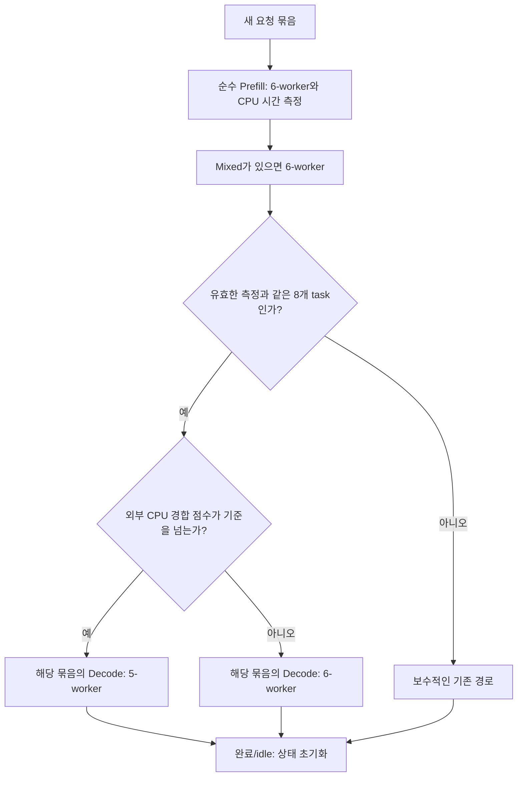

# 현재 연구 방법과 해석 범위

이 문서는 Prefill pressure 후보의 방법 설명입니다. 최종 채택 후보이며 두 독립 회복 확인 캠페인 결과는 result-summary.md/json에 있습니다. 원본 대비 전체 개선은 확인됐고, 새 worker 선택의 기여는 cpu25에서 positive, ambient에서는 inconclusive입니다. 제출 패키지 검증 상태는 completion-audit.md와 submission/archive.json을 기준으로 합니다.

## 상세 설명

B0는 역사적 원본 llama.cpp의 정확한 source revision을 재빌드한 실행본입니다. B1은 연구 시작 전에 검증된 NEW_A q4-exact runtime을 byte 그대로 보존한 것입니다. 이번 후보는 B1의 연산 라이브러리를 유지하고 server의 graph 호출 경계에서 기존 GENERATION5/BATCH6 profile 중 하나를 선택합니다. 새 SIMD·양자화·행렬 커널이나 모델 변경은 없습니다.

출발 관측은 고정 worker 수의 상충관계였습니다. 탐색에서 Decode5는 cpu25 경합 조건에서 유리했지만 무부하에서는 손해였습니다. Prefill6/Decode5를 항상 적용하는 것만으로 일반적인 개선을 얻지는 못했습니다. 고정5와의 비교에서도 phase별 분리 자체의 독립 우월성은 입증되지 않았습니다.

첫 적응 후보 D는 실제 Decode 호출에서5/6 worker를32회에 걸쳐 교차 시험하고, 이후 빠른 쪽을 선택했습니다. 기존 모델과 새 정책의 출력 일치는 유지됐지만 탐색·threadpool 전환 비용이 있었고, 어떤 요청 묶음에서는 같은 cpu25 조건에서도6을 선택했습니다. 이 후보는 보호된 checkpoint로 남겨둡니다.

후속 E는 처음의 순수 Prefill 호출을6-worker로 실행하면서 외부 CPU 사용량을 추정합니다. 선택된6 CPU의 user/nice/system 시간에서 server process 전체 CPU 시간을 빼되, clock read 구간·tick 반올림·accounting 오차를 보수적으로 처리합니다. CPU당 어느 요청이 어떤 답을 낼지는 보지 않습니다. 모델 token 값이나 이전 답변도 읽지 않습니다.

측정값이 유효하고 충분히 길며, 같은8개 task의 Decode가 이어질 때만 결정을 사용합니다. 점수가 .125core보다 높으면 multi-token Decode에5-worker를, 아니면6-worker를 사용합니다. MIXED/UNKNOWN은6-worker이며 기존 single-token Decode5는 유지합니다. 같은 task들이 차례로 끝나며 줄어드는 tail은 허용하지만 새 요청·task 교체·위치 불연속·오래된 측정에는 보수적으로 돌아갑니다. Idle에서 상태를 지우므로 warmup이나 이전 요청의 결정을 다음 요청에 재사용하지 않습니다.

이 방법은 phase 정보를 실제 의사결정에 사용합니다. Prefill6에서 측정하고 Decode에서 자원을 선택하는 연결이 source와 원시 카운터에 남습니다. 그러나 C/C-off가 빨라져도 semantic phase label이 모든 shape 기반 controller보다 낫다는 뜻은 아닙니다. 주요 가설은 경합 상황에서 불필요한 worker 경쟁과 대기 비용을 줄이는 것입니다. 원본 대비 전체 개선에는 연구 이전 NEW_A 커널의 누적 성과도 포함되므로 B1/B0, C/B1, C/C-off를 따로 측정합니다.

Scheduler는 기존 selected-child, fixed-affinity, watchdog, FULL guard 범위에서 실행합니다. 기존 handoff와 locality 정책 및 조합도 실제 pilot으로 검토했습니다. 새 runtime 정책과 scheduler가 함께 들어간 C/B1은 kernel scheduler만의 효과가 아닙니다. 동일 runtime 정책을 Linux/base/observe에 얹는 보조 비교는 이 구분을 돕습니다.

C-off는 같은 새 바이너리에서 sensor와 검사를 유지하고, 해당 multi-token Decode 선택만 합리적인 고정6으로 바꿉니다. 기존 NEW_A 연산 커널을 끄지 않습니다. 고정5 control은 경합에서의 이득과 무부하 손해, 적응 비용을 따로 보여줍니다.

평가는 실제로 서로 다른8개 요청을 동시에 실행하며, generated tokens / cohort 전체 HTTP wall time을 primary로 사용합니다. 요청 간 prompt/prefix/KV 재사용과 speculative decoding은 꺼져 있습니다. 요청 내부의 정상적인 autoregressive KV cache만 유지합니다. 고정 길이 생성은 계산량 통제용이며 응답의 의미적 품질을 보장하는 척도가 아닙니다.

현재 장비는12 logical CPU의 AMD 5500U이지만, 모든 비교군은 동일한6 physical-core representative CPU envelope를 사용합니다. Intel이나12 logical CPU 전체를 쓰는 설정의 성능은 이 결과로 주장하지 않습니다. 다른 topology에서는 CPU 선택·guard·센서 보정·worker 후보를 다시 검증해야 합니다. CPU 경합이 Prefill 이후 바뀌거나, 선택 mask 밖의 SMT·메모리·열 문제가 지배하면 이번 센서는 충분하지 않을 수 있습니다.

## ELI5

여섯 명이 함께 글을 읽고 답을 쓰는 팀이라고 생각하면 됩니다. 평소에는 여섯 명이 모두 일하는 것이 좋습니다. 그런데 다른 일이 끼어들면 한 명을 기다리느라 팀 전체가 늦어질 수 있습니다. 그때는 다섯 명으로 일을 나누는 편이 빠를 수 있습니다.

처음 방법은 실제로 다섯 명과 여섯 명을 여러 번 번갈아 시켜 보고 선택했습니다. 그 시험 자체에도 시간이 들었습니다. 새 후보는 먼저 글을 읽는 동안 다른 일이 CPU를 얼마나 쓰는지 재고, 답을 만드는 단계의 인원수를 선택합니다.

답을 외워서 다시 내놓거나 문제를 쉽게 바꾸는 방법은 아닙니다. 같은 모델이 같은 요청을 실제로 계산합니다. 이전 NEW_A가 이미 계산을 빠르게 만든 부분과, 이번에 인원을 잘 선택해서 얻는 부분은 따로 비교해야 합니다.

팀을 바꾸었다는 사실만으로 빨라졌다고 결론내리지는 않습니다. 같은 조건의 반복 비교와 두 번의 독립 확인을 마쳤습니다. 문제 묶음 두 개는 정책을 고를 때 쓰지 않았지만, 디스크 문제로 중단된 첫 시도에서 이미 본 묶음이라는 점도 기록했습니다. 전체 속도 향상의 대부분은 기존 NEW_A에서 왔고, 이번 인원 선택은 다른 CPU 작업이 있을 때 추가로 도움이 됐습니다. 잘 안 된 정책과 불확실한 결과도 함께 남겼습니다.
